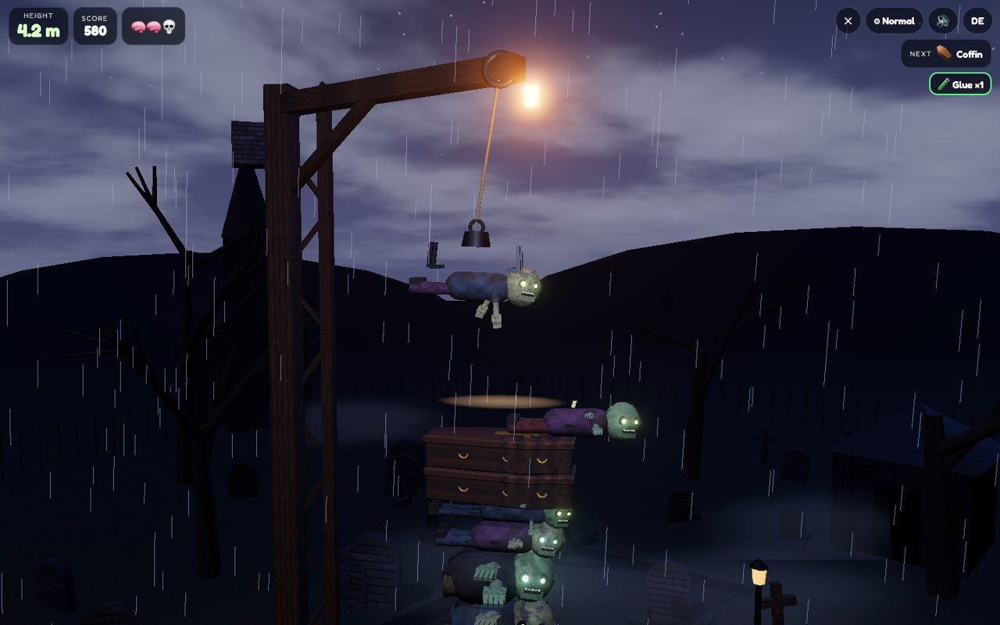
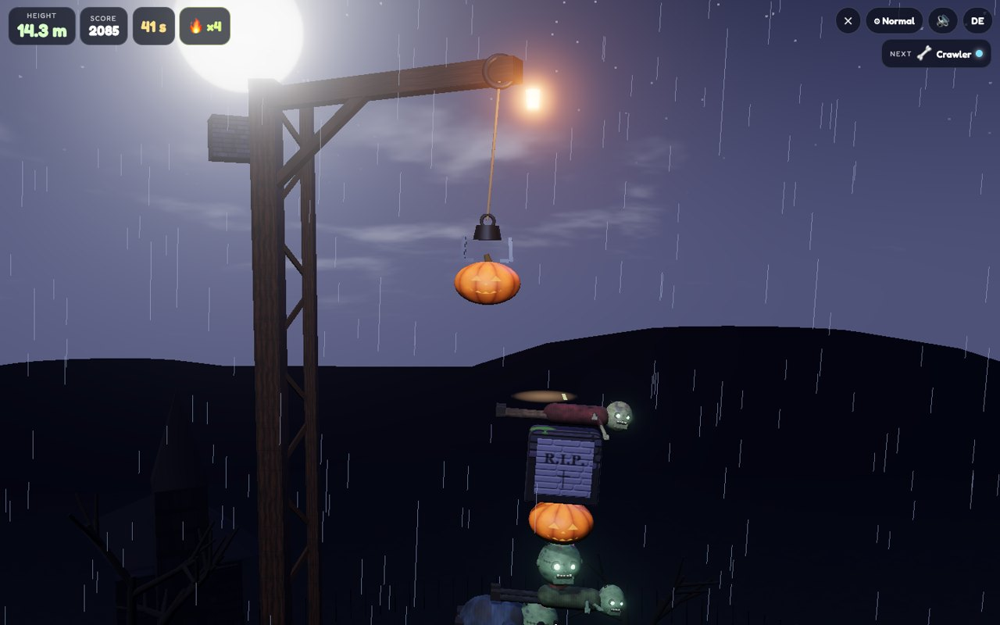
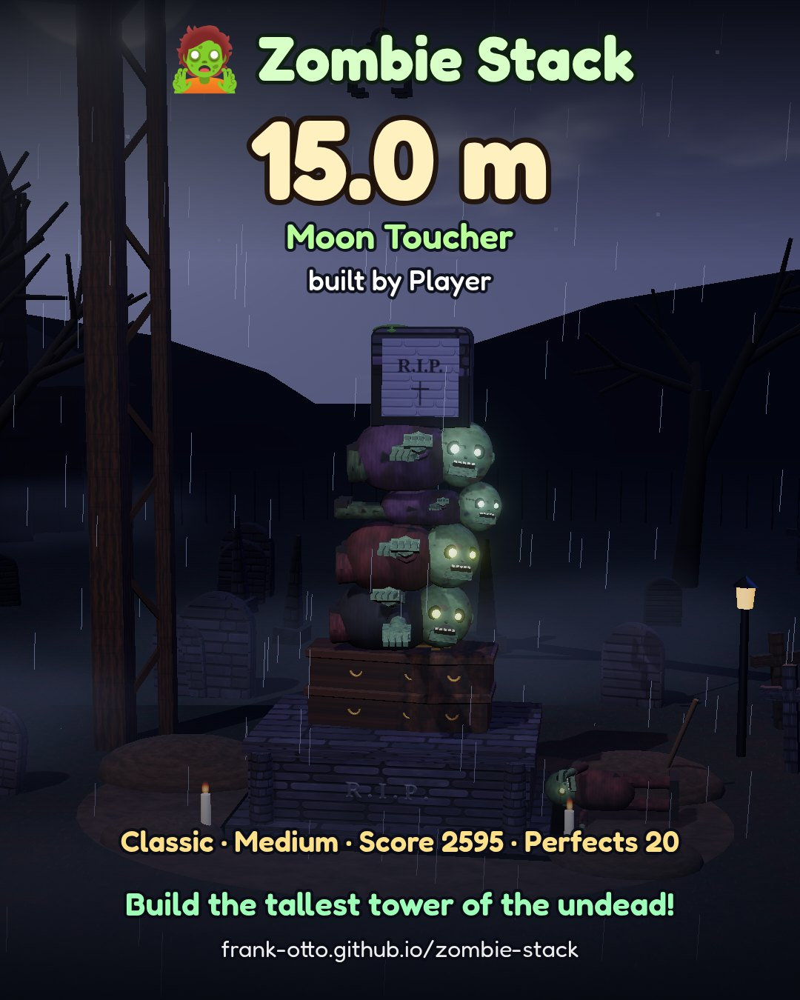

# 🧟 Zombie Stack

Day 11 of a daily Halloween web-game series – **9 days to Halloween 🎃**

Play: **[online version (GitHub Pages)](https://frank-otto.github.io/zombie-stack/)**

Midnight in the graveyard. A creaky crane swings zombies, coffins, tombstones and pumpkins over an open crypt. Drop them at the right moment and build the tallest wobbling tower of the undead – in real 3D with real physics.

## How to play
- **Tap** the screen, **click**, or press **Space** to drop the swinging piece.
- Land it **dead-centre** for a **PERFECT**: it snaps, glows and locks, and a rising organ chord plays. Chain perfects for streaks.
- Off-centre drops wobble the tower – too far and pieces tumble into the grave.
- Zombies landing on zombies **grab each other** and hold on.
- Potions on some pieces: 🧪 **Glue** (next 3 drops stick), 🧊 **Freeze** (tower frozen solid for 12 s), ⏳ **Slow-mo** (crane swings slowly for 3 drops).
- Height milestones: lightning at 3 m, a bat swarm at 6 m, the full moon rises at 10 m, above the storm at 15 m …

**Modes:** Classic (how high can you go – misses cost a life) and Timed (as high as possible before time runs out).
**Difficulty:** Easy / Medium / Hard (Hard adds wind gusts). **Kids mode:** gentle auto-straighten, misses just go "poof", never game over.

Highscore per mode, English / German, 1080×1350 share card of your tower, quality levels (Normal by default, auto step-down only if the frame rate stays low).

## Tech
- Three.js (WebGL) scene: graveyard, storm sky shader with clouds, moon and lightning, rain, fog, crane rig.
- cannon-es rigid-body physics: box/cylinder pieces with different sizes and weights, lock constraints for perfect drops, point-to-point "grabs" between zombies, a swaying kinematic lower tower, wind forces, slow-motion collapse.
- Sounds: real CC0 recordings only (groans, wood and stone thuds, crane creaks, thunder, organ) – no oscillators. Sample-based music. See `LICENSES/SOUNDS.md`.
- Everything is bundled into `js/game.bundle.js` + `js/sounds-src.js`, so it also runs straight from the file system (`start.command` or open `index.html`).

## Build & test
```
npm install
node tools/build.mjs
python3 test/test_game.py   # headless Chrome (SwiftShader) via Playwright
```

Built with Grok Bot. Sound credits by source ID in `LICENSES/SOUNDS.md`. Code licenses: three.js and cannon-es (MIT), Fredoka font (OFL).

## Screenshots



